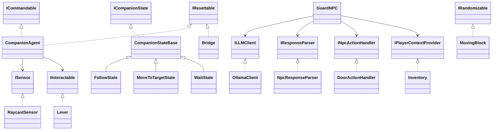
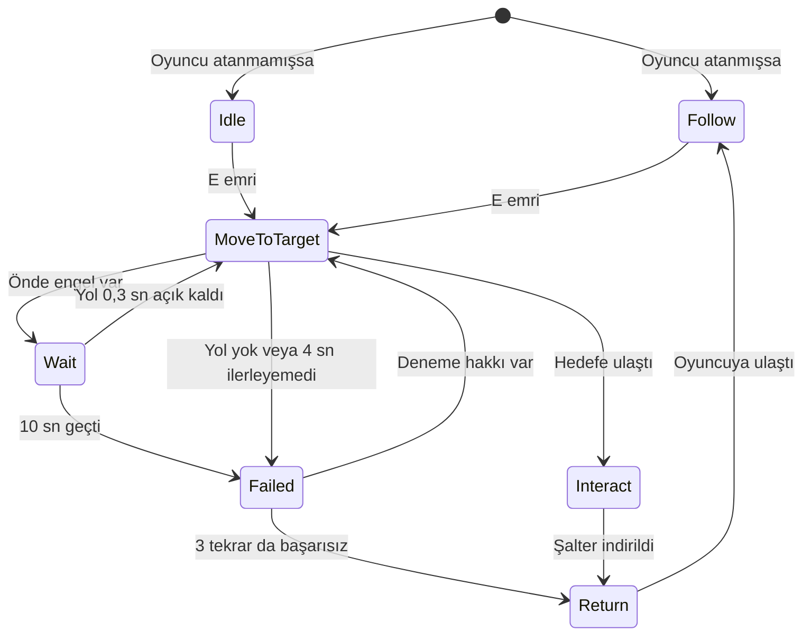
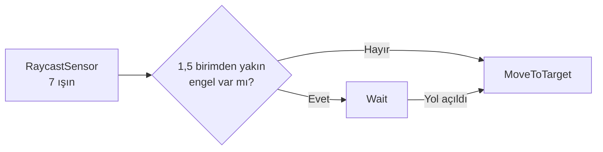

# Güney Kapısı

- **Ekip:** Zeynep Uğurlu, Osman Badar
- **Ders:** Yazılım Geliştirme Laboratuvarı-I, Proje 1
- **Tarih:** 6 Kasım 2026

## 1. Giriş

Bu projede Unity ile 3D bir macera oyunu yaptık. Oyunda
birbirinden bağımsız iki yapay zekâ bileşeni var: oyuncuya
eşlik eden Pip ve kapıyı koruyan Gorvan. Pip yolunu NavMesh
ile buluyor, kararlarını durum makinesiyle veriyor. Gorvan
ise Ollama üzerinde yerelde çalışan bir dil modeliyle
konuşuyor.

Köyde salgın var, ilaçlar ise Güney Kapısı'nın arkasındaki
depoda. Oyuncu oraya ulaşmaya çalışıyor:

1. **Yıkık köprü:** Önümüzde bir uçurum ve kalkık bir köprü
   var. Köprüyü indiren şalter, duvarlarla kapalı bir odada.
   Odaya giden alçak tünele oyuncu giremiyor, sadece Pip
   sığıyor. Oyuncu E'ye basınca Pip şaltere gidiyor.
2. **Kamp:** Köprüden sonra kamp alanı geliyor. Burada
   muhtarın mektubu bulunuyor. Mektubu almak zorunlu değil.
3. **Güney Kapısı:** Oyuncu Gorvan'la serbest metinle
   konuşuyor. Gorvan ikna olursa kapı açılıyor ve oyun
   kazanılıyor. Gorvan saldırırsa oyun kaybediliyor.

### Sınıf yapısı

## 2. Otonom Kahraman: Pip

Pip'e rota vermiyoruz, sadece hedef veriyoruz. Şaltere giden
yolu `NavMeshAgent` kendisi hesaplıyor. Köprü indiğinde
NavMesh yeniden oluşturuluyor, böylece Pip karşıya da geçip
oyuncuyu takip edebiliyor.

Karar mantığı `CompanionAgent` içindeki durum makinesinde.
Her durum `ICompanionState` arayüzünü uygulayan ayrı bir
sınıf olduğu için yeni bir durum eklerken diğerlerini
değiştirmemiz gerekmiyor.

| Durum | Pip ne yapıyor? |
|---|---|
| Idle | Bekliyor. |
| Follow | Oyuncuya 2,5 birimden uzaksa onu takip ediyor. |
| MoveToTarget | Şaltere gidiyor, yolu ve ilerlemesini kontrol ediyor. |
| Wait | Önünde engel varsa durup yolun açılmasını bekliyor. |
| Interact | Şalteri indiriyor. |
| Failed | 1 sn bekleyip yolu yeniden deniyor. En fazla 3 tekrar yapıyor. |
| Return | Oyuncunun yanına dönüyor. |

### Sensör

Tünelde yolu kesip açan hareketli bloklar var. Pip bunları
`RaycastSensor` ile algılıyor. Sensör, Pip'in önündeki 90
derecelik alana 7 ışın gönderiyor ve her ışın için mesafe ile
açıyı kaydediyor. Işınların menzili 4 birim. Önündeki ±35
derecelik alanda 1,5 birimden yakın bir engel varsa Pip
`Wait` durumuna geçiyor.

## 5. Testler

### Pip

`Test_CompanionRuns` sahnesinde `CompanionTestRunner` Pip'i 5
farklı başlangıç noktasından 10'ar kez çalıştırdı. Her
denemede hareketli blokların ayarları rastgele değişti.
Sonuçları tekrar alabilmek için sabit seed (12345) kullandık.
Ham veri: [CSV dosyası](docs/companion_results_20261031_041426.csv)

| Başlangıç noktası | Başarı | Ortalama (sn) | En kısa (sn) | En uzun (sn) |
|---|---|---|---|---|
| 1 | 10/10 | 7,80 | 6,60 | 9,02 |
| 2 | 10/10 | 7,33 | 5,85 | 9,32 |
| 3 | 10/10 | 6,44 | 5,59 | 7,51 |
| 4 | 10/10 | 5,92 | 5,08 | 7,55 |
| 5 | 10/10 | 6,69 | 5,99 | 7,46 |
| **Toplam** | **50/50** | **6,83** | **5,08** | **9,32** |

Süreler oyun zamanı. Test 2x hızda çalıştığı için gerçek
süre yaklaşık yarısı kadar. Hiçbir deneme zaman aşımına
uğramadı.

### Gorvan

Yedi senaryoyu denedik: ikna, kızdırma, alakasız konuşma,
kandırma, prompt injection, mektup ve veda. 17 denemenin
15'inde eylem doğru çıktı. Bazı denemeler ayrı konuşmada
yapılmadı, bunları sonuç dosyasında işaretledik. Tüm
cevaplar: [Gorvan test sonuçları](docs/llm-tests/sonuclar.md)

Yanlış çıkan iki denemeden birinde Gorvan "geç" dediği halde
`none` döndü. Diğerinde kaba mesajlara "Bu son uyarım"
demeye devam etti ve saldırmadı.

## 6. Sonuç ve Tartışma

Minimum senaryoyu baştan sona çalıştırabildik. Pip 50 denemenin
50'sinde şaltere ulaştı. Gorvan testlerinde 17 denemenin 15'inde
eylem doğru çıktı. Kapıyı `action` alanı açtığı için oyunun
davranışı serbest metne bağlı kalmadı.

En zayıf yanımız dil modeli. Gorvan bazen "geç" deyip kapıyı
açmıyor, bazen kaba mesajlara rağmen saldırmıyor. Mektup kuralı
da modele bağlı. Mektup yokken yaptığımız oyun içi testlerde
yalana inanmadı, ama doğrudan Ollama'ya yaptığımız bir denemede
4 mesajın 2'sinde kapıyı açtı. Sabit seed sonuçları
tekrarlanabilir yapıyor, ama her cümlede doğru karar vereceğini
garanti etmiyor.

Daha fazla zamanımız olsaydı daha büyük bir modeli denemek ve
Gorvan senaryolarının deneme sayısını artırmak isterdik. Oyun
tarafında ise karakterler için model ve animasyon eklemek,
görselleri geliştirmek isterdik.